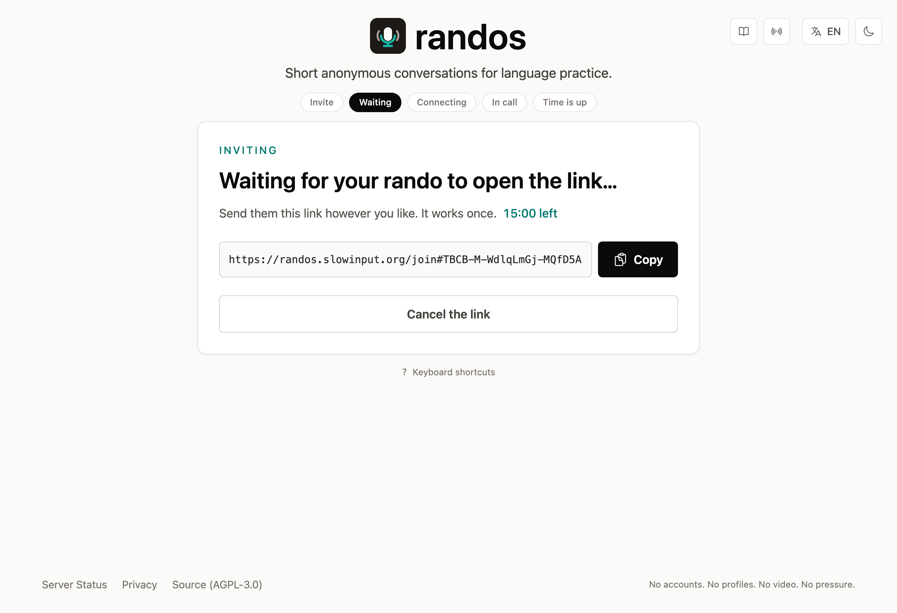
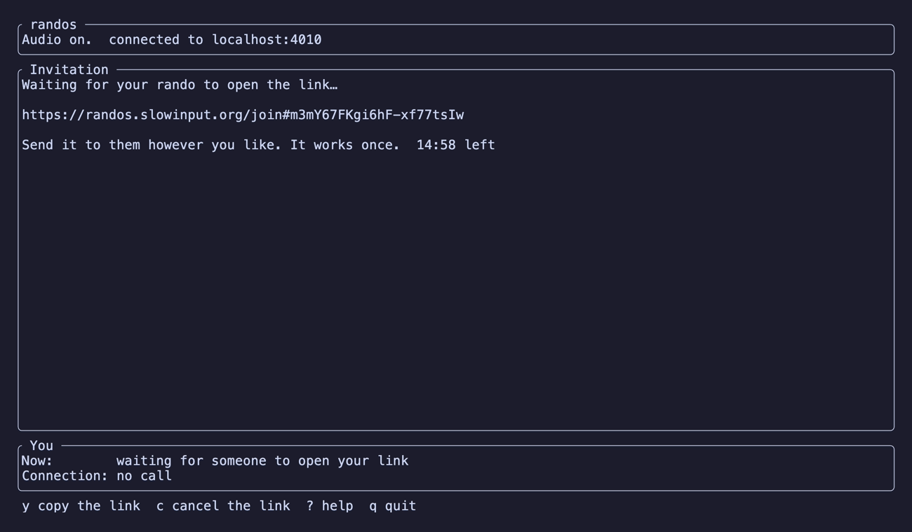

<p align="center">
  
</p>

<h1 align="center">randos</h1>

<p align="center">
  Short, anonymous, audio-only conversations for language practice.<br>
  In your browser at <a href="https://randos.slowinput.org">randos.slowinput.org</a>, or in your terminal.
</p>

<p align="center">
  <a href="https://github.com/wasichu/randos/releases"></a>
  <a href="https://github.com/wasichu/randos/actions/workflows/ci.yml"></a>
  <a href="LICENSE"></a>
</p>

Pick the language you'll speak and the one you want to hear, and randos
pairs you with a stranger who wants the opposite: a short voice call, then
you both disappear. No accounts, no profiles, no video, no pressure.

<picture>
  <source media="(prefers-color-scheme: dark)" srcset="docs/assets/web-call-dark.png">
  
</picture>

## How it works

1. Choose the language you'll speak, and every language you're happy to
   hear. You can practise both ways (I speak Spanish, you speak English),
   both speak the same language, or just listen.
2. Confirm you're 18 or older. Calls are anonymous and unmoderated.
3. randos finds someone who speaks a language you're happy to hear and is
   happy to hear yours, and connects the two of you. Whoever has waited
   longest is matched first, and you won't be matched with the same person
   again straight away.
4. You talk for ten minutes. When time is up, you both choose whether to
   keep going, ten more minutes at a time, up to thirty. Either of you can
   end the call or move on to the next rando at any moment. If your
   network changes or drops for a moment (Wi-Fi to mobile data, a tunnel),
   the call says "Reconnecting audio…" and comes back on its own, within
   fifteen seconds, or ends if it can't.

You can also bring someone you know: "Invite someone" makes a private,
one-time link to send them (it works for 15 minutes); whoever opens it
joins a call with you, the same ten minutes and the same vote, and you
both go back to the form afterwards, never to a stranger.

<picture>
  <source media="(prefers-color-scheme: dark)" srcset="docs/assets/web-invite-dark.png">
  
</picture>

That's all there is. Nothing about the call is kept. The site speaks
all 20 languages, with a switcher in the navigation. Its translations are
machine-made, so
[/translations](https://randos.slowinput.org/translations) lists every
string next to the English: "Suggest a fix" opens a GitHub issue with
everything filled in but your fix, and a pull request follows on its own.
Why these 20 languages, and how to add one:
[docs/languages.md](docs/languages.md).

[randos.slowinput.org/status](https://randos.slowinput.org/status) shows
whether calls can connect right now and how many there have been today:
calls, not people.

## In your browser

Open [randos.slowinput.org](https://randos.slowinput.org) and allow the
microphone when asked. Tested in Chrome and Safari, on desktop and mobile.

Before a call, expand **Voice masking** in the setup card. It offers a changed tone, with or without a gentle
pitch change. Choose Fuller or Brighter and use **Hear myself** with headphones
to try it locally. Preview stays on as you change styles; choosing Off lets you
hear your original voice. Nothing is recorded or uploaded. Masking starts off in each
new session; it changes how you sound, but people may still recognize you.

Press **?** or click **Keyboard shortcuts** below the homepage form to show
the shortcut bar and activate
**F** Find, **I** Invite, **P** microphone preview, and **M** mute during a call.
**X** stops looking while you’re queued. **A** toggles the acknowledgment checkbox and **B** opens/closes Voice masking.
During a call, **E** ends it and **N** moves on to the next rando (except invitation calls).
**P** opens the voice panel if needed; with it open, **S** cycles Style and **T**
cycles Tone. **O** opens About, **R** Server Status, and **L** the interface-language
menu (arrows move, Enter applies, Esc closes the menu first). Letters work in either case. **?** or **Esc** hides the bar and disables shortcuts. **Server Status**
shows connection health and call counts. Once you open shortcuts, this browser
remembers to show them when you return or change language. Esc hides them for
the current visit.

## In your terminal

The same calls, from a terminal (macOS on Apple Silicon, or Linux x86_64
with glibc 2.39 or newer, e.g. Ubuntu 24.04). Terminal users and browser
users can be matched with each other.

```bash
brew install wasichu/randos/randos
randos
```

In the terminal, press **b** before finding someone to open Voice masking.
Choose a style with **1/2/3**, change tone with **left/right**, and press **p**
to hear yourself or stop. Preview stays on while you change style or tone;
Off lets you hear your original voice. **Esc** closes the preview. Choices last for this
session and apply to your next call. Press **l** to choose the interface
language from a list; arrows move, Enter applies, Esc cancels. See the [voice panel](docs/assets/tui-voice.png).

On Linux without Homebrew, download the archive from the
[latest release](https://github.com/wasichu/randos/releases/latest), unpack
it anywhere, and run `bin/randos` (it needs ALSA, OpenSSL 3 and the system C++
standard library—`libstdc++6` on Ubuntu—which most desktop distributions have).

<table>
  <tr>
    <td></td>
    <td></td>
  </tr>
  <tr>
    <td colspan="2"></td>
  </tr>
</table>

- The essential keys for each screen are listed along the bottom; press **?**
  for all shortcuts available on that screen (**Esc** closes help, **↑/↓** scroll).
  Use arrows to pick languages (space checks the ones you're happy to hear)
  and Enter to find a rando. During a call, `m` to mute, `n` for the next rando, `e` to end the call, `q` to
  quit.
- `v` invites someone you know: it shows a one-time link to send them
  (`y` copies it, `c` withdraws it). `j` joins through a link you were
  sent: paste it and press Enter (pasting on the start screen opens the
  prompt too). Browser and terminal users can invite each other.
- `t` shows a mic level meter (silent: nothing is played back); `t` again
  hides it and closes the mic. `i` and `o` choose the mic
  and speaker. `s` shows the server's status, as on
  [/status](https://randos.slowinput.org/status); `i` there says what's
  counted and what isn't.
- Your languages, the 18+ confirmation, and your mic and speaker are
  remembered on your computer: `randos --settings` shows where,
  `--edit-settings` opens them in your editor, `--reset-settings` forgets
  them.
- Echo is cancelled, so speakers work, but headphones sound best.
- On macOS, the first call asks for microphone access for your terminal app.
- `randos --check` tells you whether the audio part works.
- Logs go to `~/Library/Caches/randos/tui.log` (macOS) or
  `~/.cache/randos/tui.log` (Linux). They never contain audio.

## Privacy

- **No accounts and no history.** There is no database: the waiting room and
  the calls exist only in the server's memory and vanish when they end.
- **The server never hears you.** Audio is encrypted between the two of
  you (WebRTC) and passes through our relay, which forwards it without
  being able to decrypt it.
- **No recording, no ads, no tracking.** The site loads nothing from other
  companies: no analytics, no fonts, no CDNs.
- **Your IP address stays between you and our servers.** Like any
  website, the server sees it while you're connected. The person you're
  talking to never does: every call goes through our relay, and the server
  strips direct addresses from everything it passes between you.

What each part sees, logs, and keeps, with the configuration behind every
claim: [privacy](docs/privacy.md).

## Why randos is like this

randos is intentionally constrained:

- no accounts
- no profiles
- no followers, feeds, streaks, ratings, or scores
- no video
- no recording
- no server-side audio access
- no permanent social graph
- no ads, no tracking, no charging

It is not a social network, a content platform, or a gamified dopamine
delivery system. It's closer to public conversational infrastructure: a
calm place where adults can briefly meet, talk, and then disappear. It
supports crosstalk, language exchange, listening practice, and casual
conversation without forcing people into rigid modes or progress loops.
The product should feel like a doorway, not a platform.

randos is free infrastructure for the language-learning community, run as a
service. Donations may be welcome someday.

## Working on randos or running your own

- [Development](docs/development.md): setting up, running it locally, the
  tests, and how the code is laid out.
- [Self-hosting](docs/self-hosting.md): running your own instance, its
  configuration, and the TURN relay.

## License

randos is free software under the GNU Affero General Public License,
version 3 or (at your option) any later version: see [`LICENSE`](LICENSE).
Anyone may use, change, and share it; if you run a modified randos for
others to use over a network, you must offer them its source too.
