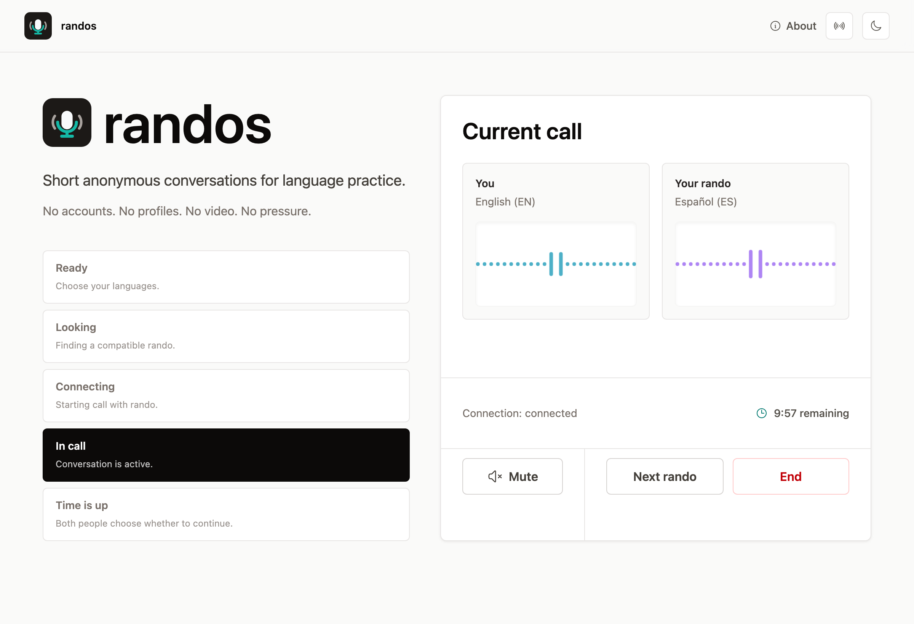
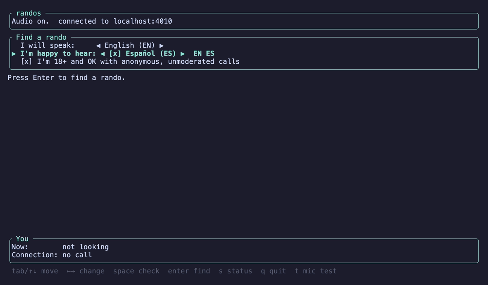
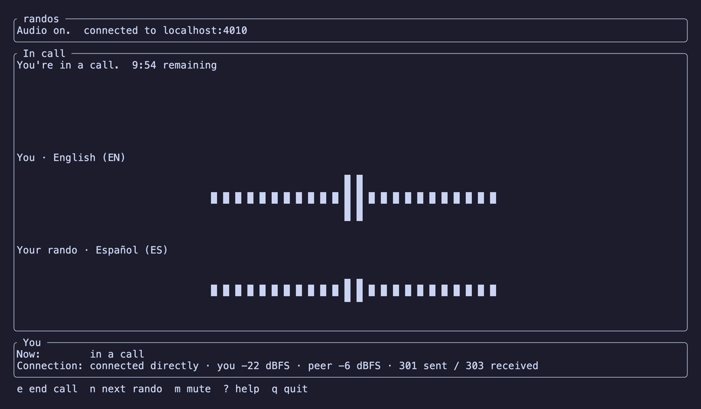

<p align="center">
  
</p>

<h1 align="center">randos</h1>

<p align="center">
  Short, anonymous, audio-only conversations for language practice.<br>
  In your browser at <a href="https://randos.slowinput.org">randos.slowinput.org</a>, or in your terminal.
</p>

<p align="center">
  <a href="https://github.com/wasichu/randos/releases"></a>
  <a href="https://github.com/wasichu/randos/actions/workflows/ci.yml"></a>
  <a href="LICENSE"></a>
</p>

Pick the language you'll speak and the one you want to hear, and randos
pairs you with a stranger who wants the opposite: a short voice call, then
you both disappear. No accounts, no profiles, no video, no pressure.

<picture>
  <source media="(prefers-color-scheme: dark)" srcset="docs/assets/web-call-dark.png">
  
</picture>

## How it works

1. Choose the language you'll speak, and every language you're happy to
   hear. You can practise both ways (I speak Spanish, you speak English),
   both speak the same language, or just listen.
2. Confirm you're 18 or older. Calls are anonymous and unmoderated.
3. randos finds someone who speaks a language you're happy to hear and is
   happy to hear yours, and connects the two of you. Whoever has waited
   longest is matched first, and you won't be matched with the same person
   again straight away.
4. You talk for ten minutes. When time is up, you both choose whether to
   keep going, ten more minutes at a time, up to thirty. Either of you can
   end the call or move on to the next rando at any moment. If a
   connection drops for a moment, the call waits a few seconds for it to
   come back.

That's all there is. Nothing about the call is kept. The site itself is
in English for now, with a language switcher in the header; translations
into the other languages are on their way.

[randos.slowinput.org/status](https://randos.slowinput.org/status) shows
whether calls can connect right now and how many there have been today:
calls, not people.

## In your browser

Open [randos.slowinput.org](https://randos.slowinput.org) and allow the
microphone when asked. Tested in Chrome and Safari, on desktop and mobile.

## In your terminal

The same calls, from a terminal (macOS on Apple Silicon, or Linux x86_64
with glibc 2.39 or newer, e.g. Ubuntu 24.04). Terminal users and browser
users can be matched with each other.

```bash
brew install wasichu/randos/randos
randos
```

On Linux without Homebrew, download the archive from the
[latest release](https://github.com/wasichu/randos/releases/latest), unpack
it anywhere, and run `bin/randos` (it needs ALSA and OpenSSL 3, which most
desktop distributions have).

<table>
  <tr>
    <td></td>
    <td></td>
  </tr>
</table>

- The keys for each screen are listed along the bottom: arrows to pick
  languages (space checks the ones you're happy to hear), Enter to find a
  rando, `m` to mute, `n` for the next rando, `e` to end the call, `q` to
  quit.
- `t` shows a mic level meter (silent: nothing is played back); `t` again
  hides it and closes the mic. `i` and `o` choose the mic
  and speaker. `s` shows the server's status, as on
  [/status](https://randos.slowinput.org/status).
- Your languages, the 18+ confirmation, and your mic and speaker are
  remembered on your computer: `randos --settings` shows where,
  `--edit-settings` opens them in your editor, `--reset-settings` forgets
  them.
- Echo is cancelled, so speakers work, but headphones sound best.
- On macOS, the first call asks for microphone access for your terminal app.
- `randos --check` tells you whether the audio part works.
- Logs go to `~/Library/Caches/randos/tui.log` (macOS) or
  `~/.cache/randos/tui.log` (Linux). They never contain audio.

## Privacy

- **No accounts and no history.** There is no database: the waiting room and
  the calls exist only in the server's memory and vanish when they end.
- **The server never hears you.** Audio goes directly between the two of
  you, encrypted (WebRTC). When a direct connection isn't possible, it goes
  through a relay that passes the encrypted audio along without being able
  to decrypt it.
- **No recording, no ads, no tracking.** The site loads nothing from other
  companies: no analytics, no fonts, no CDNs.
- **Your IP address stays between you and our servers.** Like any
  website, the server sees it while you're connected. The person you're
  talking to never does: every call goes through our relay, and the server
  strips direct addresses from everything it passes between you.

What each part sees, logs, and keeps, with the configuration behind every
claim: [privacy](docs/privacy.md).

## Why randos is like this

randos is intentionally constrained:

- no accounts
- no profiles
- no followers, feeds, streaks, ratings, or scores
- no video
- no recording
- no server-side audio access
- no permanent social graph
- no ads, no tracking, no charging

It is not a social network, a content platform, or a gamified dopamine
delivery system. It's closer to public conversational infrastructure: a
calm place where adults can briefly meet, talk, and then disappear. It
supports crosstalk, language exchange, listening practice, and casual
conversation without forcing people into rigid modes or progress loops.
The product should feel like a doorway, not a platform.

randos is free infrastructure for the language-learning community, run as a
service. Donations may be welcome someday.

## Working on randos or running your own

- [Development](docs/development.md): setting up, running it locally, the
  tests, and how the code is laid out.
- [Self-hosting](docs/self-hosting.md): running your own instance, its
  configuration, and the TURN relay.

## License

randos is free software under the GNU Affero General Public License,
version 3 or (at your option) any later version: see [`LICENSE`](LICENSE).
Anyone may use, change, and share it; if you run a modified randos for
others to use over a network, you must offer them its source too.
