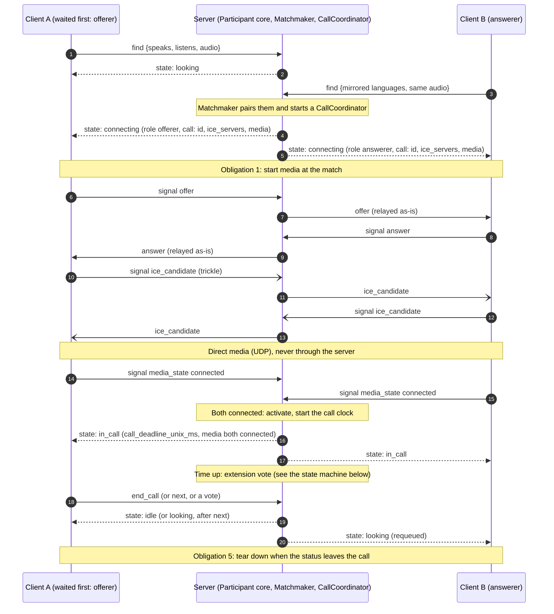
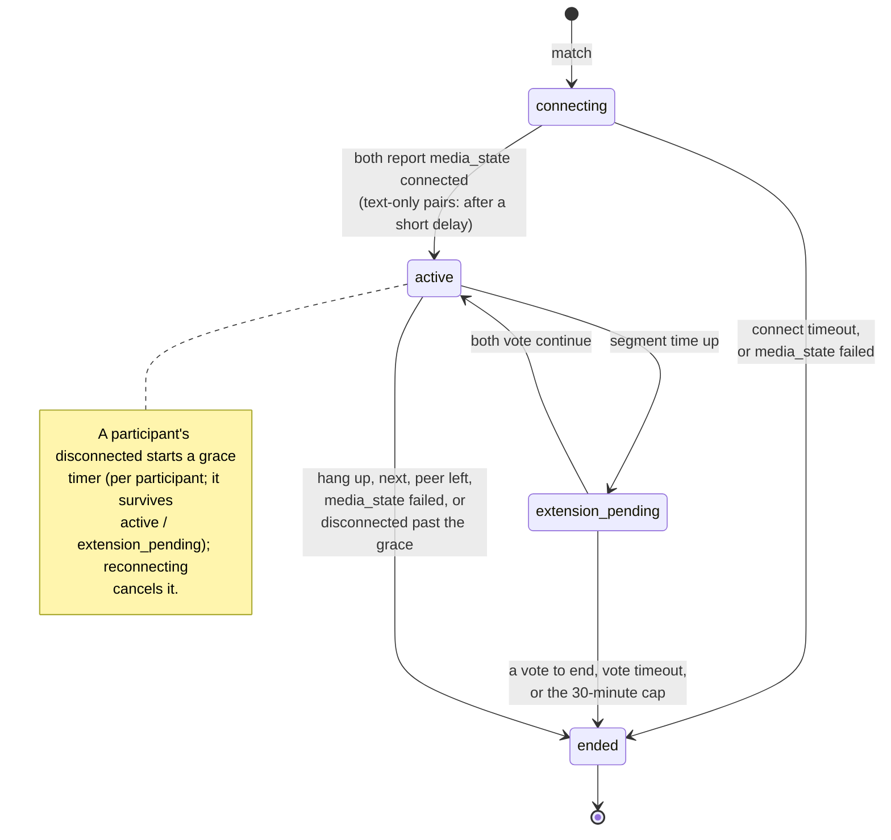
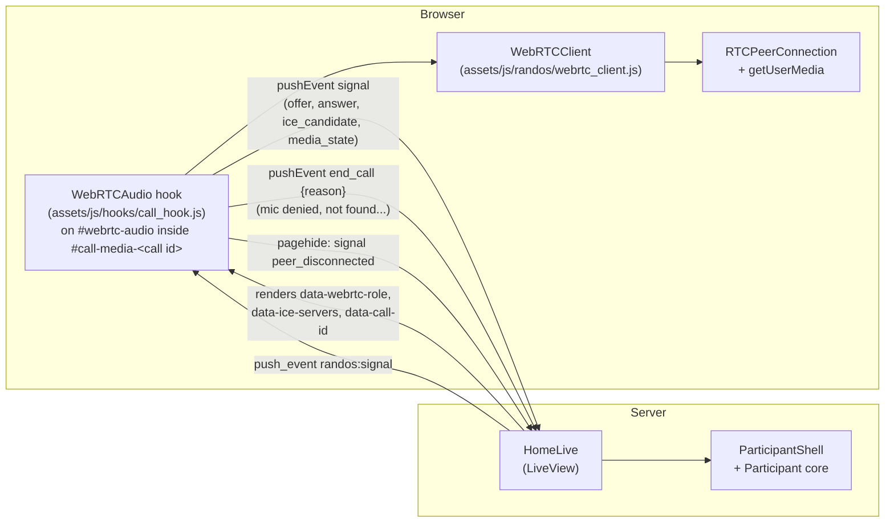
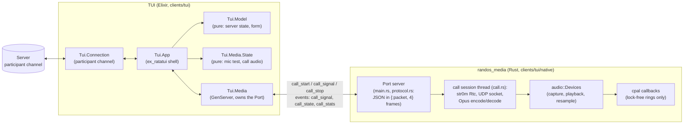
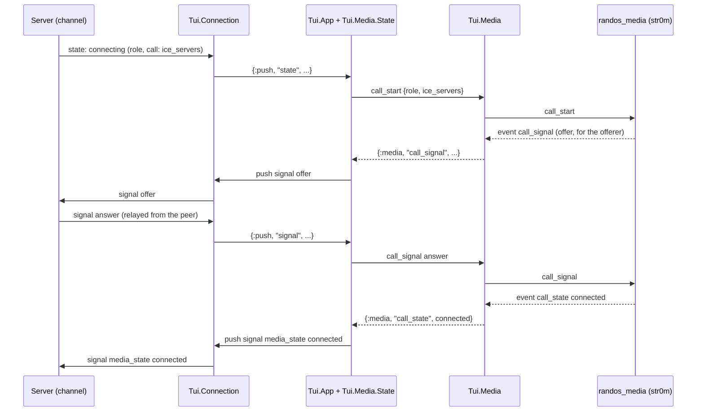

# Call flow: how a call happens, for the browser and the TUI

Diagrams of the WebRTC call flow, as built (2026-10-20). The protocol itself
is specified in [`participant_channel.md`](participant_channel.md) (its
"Client obligations" are the contract both clients follow); call timing
values live in `Randos.Calls.Lifecycle`. These diagrams show how the pieces
fit; when they disagree with the code or the protocol doc, those win.

The two clients are different UIs over the same behaviour: the server owns
matching and call health, and both clients meet the same obligations. Only
the transport to the server and the media stack differ.

## Shared: one call, start to finish

Both clients do exactly this. "Client" is the browser (LiveView) or the TUI
(participant channel); the server side is the same code for both.

## Shared: call health, owned by the server

`CallCoordinator`'s states, with the rules both clients rely on. Clients run
none of these timers themselves.

How a call ends decides who is requeued:

| Ending | `ended_reason` | Who goes back to `looking` |
| --- | --- | --- |
| `end_call` (incl. "can't start audio", with a reason) | `hangup` | only the peer; the sender goes `idle` (with `error`) |
| `next` | `hangup` | both |
| leaving on purpose (`peer_disconnected`) | `peer_disconnected` | the peer |
| a client's process just goes away | `disconnected` | the peer |
| never connects, `failed`, disconnected past the grace | `connection_failed` | both |

## Different: the browser

The browser talks to the server through its LiveView (`RandosWeb.HomeLive`)
and does media with the browser's own WebRTC.

- The call element is keyed by call id, so every call (even an instant
  rematch) gets a fresh hook and peer connection.
- ICE servers arrive as a DOM attribute when the call element renders.
- Media state comes from the peer connection's `iceConnectionState` /
  `connectionState`; each change is reported once.

## Different: the TUI

The TUI talks to the server over the participant channel (`Tui.Connection`,
Slipstream) and does media in a separate Rust process, the media helper,
over an Erlang Port. Elixir keeps signaling and UI; Rust owns all media.

How a signal travels inside the TUI (the server sees the same `signal`
events as from a browser):

- `Tui.Media.State` is pure: it turns server pushes and helper events into
  commands (requests to the helper, pushes to the channel), so the app is a
  thin shell.
- If the helper can't start or restarts mid-call, the TUI sends `end_call`
  with a reason (obligation 6); quitting mid-call sends `peer_disconnected`
  first (obligation 7).
- Without a working helper the TUI is text-only: it sends `audio: false` in
  `find` and is only matched with other text-only clients.

## What's the same, what's different

| | Browser | TUI |
| --- | --- | --- |
| Transport to the server | LiveView (`HomeLive`) | participant channel (`ParticipantChannel`) |
| Server code behind it | `ParticipantShell` + `Participant` (shared) | same |
| Call policy (activation, timeouts, failure) | server (`CallCoordinator`) | same |
| Client obligations | `participant_channel.md` | same, same tests |
| ICE servers arrive in | a DOM attribute on the call element | the `state` push's call map |
| WebRTC stack | the browser's | str0m in the Rust helper |
| Mic, speaker, codec | browser (Opus) | cpal + libopus + resampling in the helper |
| "I'm leaving" | `pagehide` → `peer_disconnected` | quit → `peer_disconnected` (`Tui.Connection.leave/2`) |
| Error text | from the server (`ParticipantErrors`) | same, via `error_message` |
